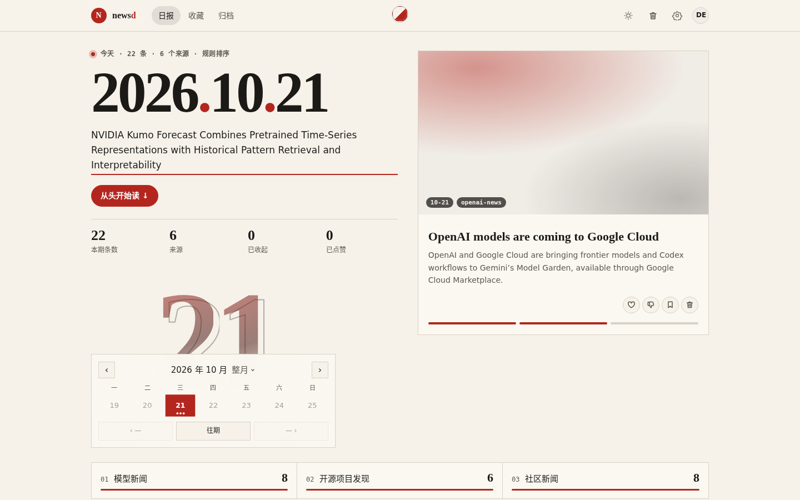
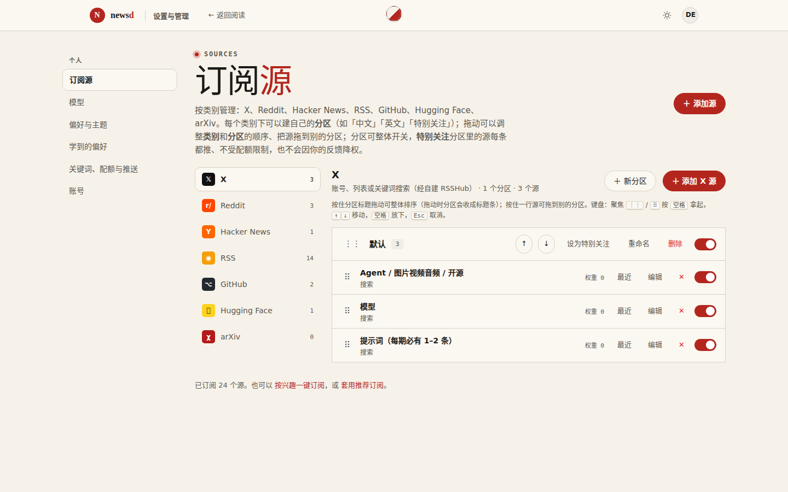
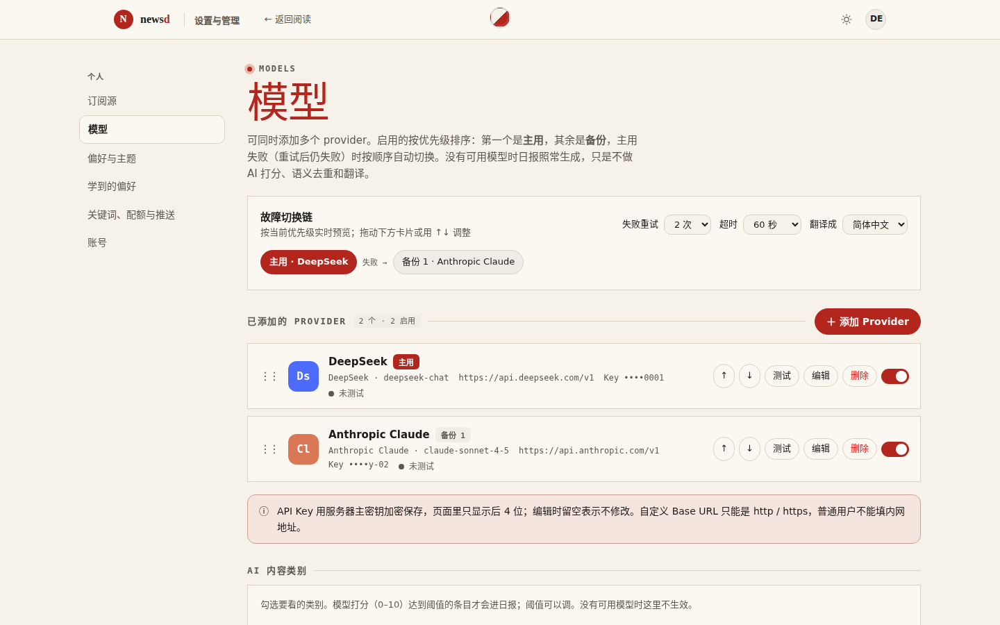
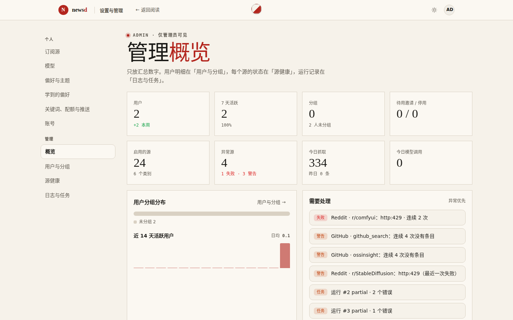
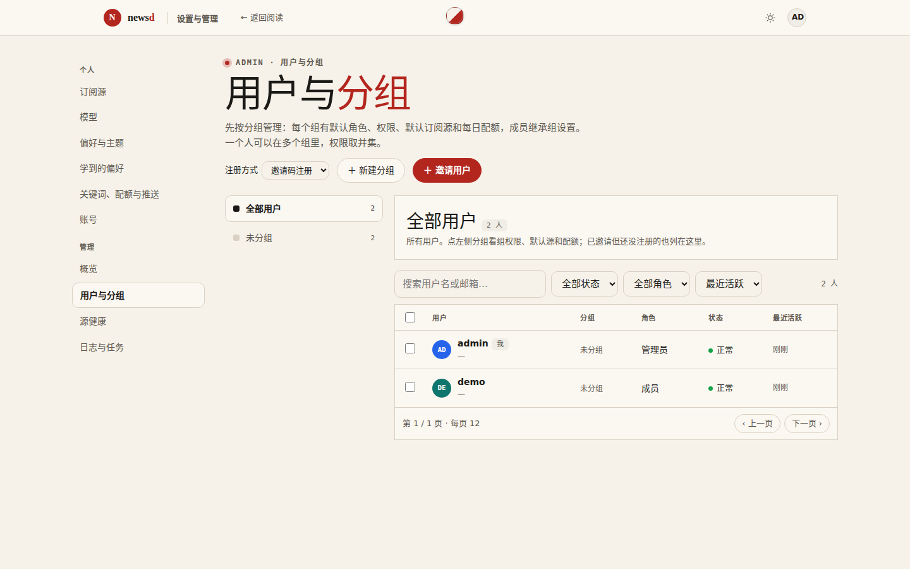
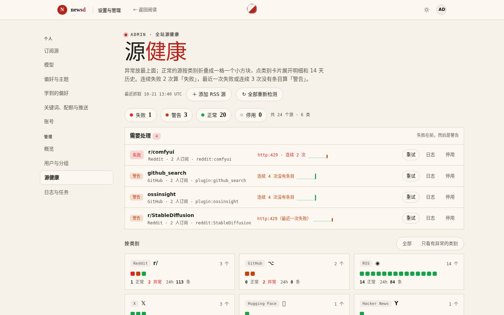
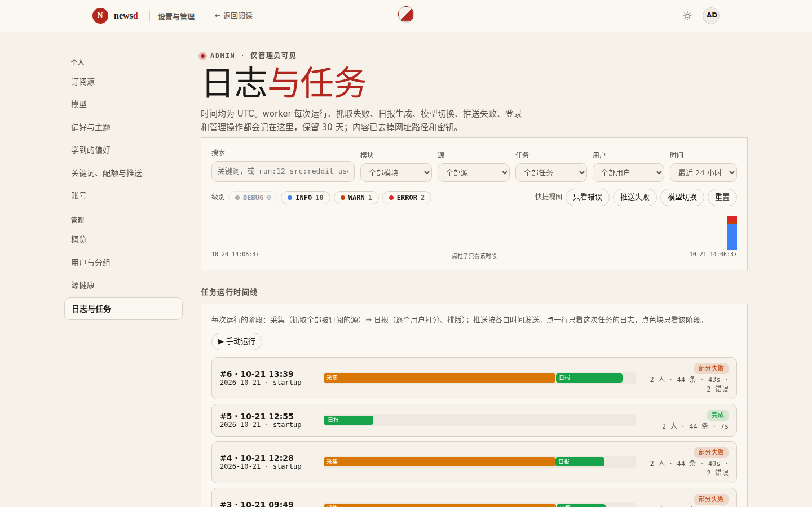
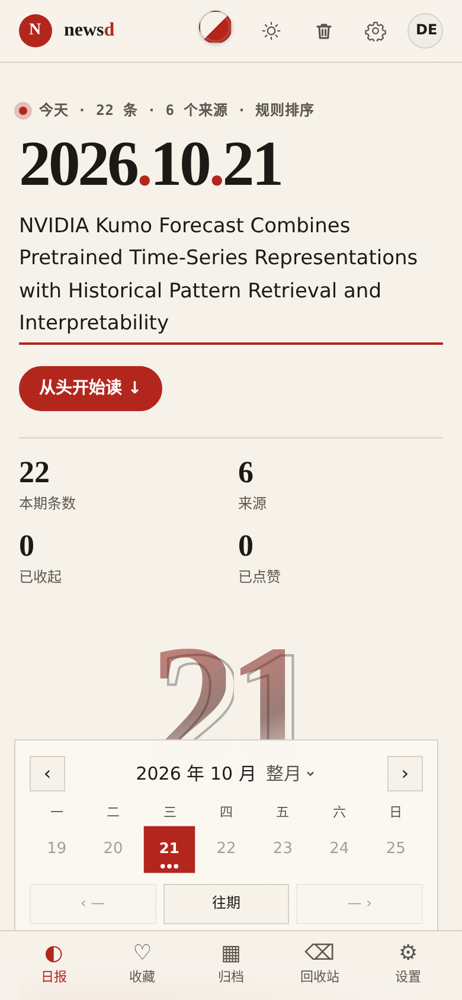

<div align="center">

# newsd

**可自托管的多用户 AI 日报。** 每个人订阅自己的信息源和关键词，newsd 每天定时采集、去重、打分，生成一份个人日报，并推送到你常用的地方。

[](https://github.com/lthero-big/newsd/actions/workflows/ci.yml)
[](LICENSE)


[功能](#功能) · [截图](#截图) · [快速开始](#快速开始) · [文档 Wiki](https://github.com/lthero-big/newsd/wiki) · [部署](https://github.com/lthero-big/newsd/wiki/Deployment) · [常见问题](https://github.com/lthero-big/newsd/wiki/FAQ)

</div>

*newsd is a self-hosted, multi-user AI news digest: per-user sources, keywords and quotas, a scheduled daily issue, optional LLM re-ranking / translation / summaries with automatic provider failover, push delivery to Telegram, e-mail and webhooks, and an admin console with user groups, source health and structured logs. Python, FastAPI, SQLite or Postgres. MIT licensed.*

## 功能

**阅读**
- 每天一期个人日报：首屏大号日期、当期导语、按分组的模块标签、日历翻看往期；手机和桌面都能用，内置 14 套主题和明暗切换。
- 卡片上可以点赞、点踩、折叠、删除和收藏；newsd 会从你的反馈里学习，逐渐给不喜欢的内容降权。删除的条目进回收站，30 天后自动清理。
- 收藏、归档搜索、回收站各有独立页面。

**信息源**
- 内置 Hacker News、Reddit、RSS/Atom、GitHub、Hugging Face、arXiv、OSSInsight，以及经自建 RSSHub 接入的 X 等。
- 按类别管理，每个类别下可以建自己的**分区**（如「中文」「英文」「特别关注」），拖动排序、整体开关；「特别关注」分区的源每条必推，不受配额限制。
- 所有用户共享一个采集池，同一个源每轮只抓一次；自动抽取正文和发布时间，内置 SSRF 防护。

**大模型（可选）**
- 支持 OpenAI 兼容接口、Anthropic、Gemini、DeepSeek、通义、豆包、硅基流动、OpenRouter、Ollama 等。
- 每个人可以添加多个 provider 组成**故障切换链**：主用失败自动换备份。key 用服务器主密钥加密存储，页面上只显示后 4 位。
- 不配模型也能正常出日报，只是少了 AI 打分、语义去重、翻译和摘要。

**推送**
- Telegram、SMTP 邮件、Webhook（通用 / 飞书 / 钉钉 / Slack / Discord，支持 `#{变量}` 模板）。
- 失败自动退避重试，有投递记录和一键测试。

**多用户与管理后台**
- 管理员、成员、只读三种角色；邀请码 / 公开 / 关闭三种注册方式，可随时切换；登录失败 3 次锁定 IP 15 分钟。
- **用户分组**：每个组有默认角色、权限、默认订阅源和每日配额，一个人可以属于多个组，权限取并集；支持批量加组、停用、强制下线、重置密码，批量生成绑定分组的邀请链接。
- **源健康**：每个源的失败 / 警告 / 正常状态和 14 天历史，一键重试。
- **日志与任务**：结构化事件日志（抓取、日报、模型切换、推送、登录、管理操作，保留 30 天并自动脱敏），以及每次定时任务的运行时间线。
- 每个用户可以生成 API key，供脚本读取自己的日报。

## 截图

| 每日日报 | 订阅源与分区 |
| --- | --- |
|  |  |
| **模型与故障切换** | **管理概览** |
|  |  |
| **用户与分组** | **源健康** |
|  |  |
| **日志与任务** | **手机端** |
|  |  |

## 快速开始

只需要 Docker（含 Compose 插件），使用 Docker Hub 上的预构建镜像 [`lthero1/newsd`](https://hub.docker.com/r/lthero1/newsd)（amd64 / arm64）：

```bash
git clone https://github.com/lthero-big/newsd.git && cd newsd
echo "NEWSD_SECRET_KEY=$(openssl rand -base64 48 | tr -d '\n=+/')" > .env   # 主密钥，保存好，不要更换
docker compose pull && docker compose up -d       # 启动 web（端口 8080）和定时 worker
docker compose exec web newsd create-admin admin  # 创建管理员
docker compose exec web newsd db import-config \
  --sources /app/config/collect-sources.json --tags /app/config/tags.json   # 导入默认信息源和标签
```

浏览器打开 http://localhost:8080 登录即可。不想克隆仓库、本机直接运行、Vercel + Supabase、反向代理和 HTTPS 等，见 Wiki 的 [部署](https://github.com/lthero-big/newsd/wiki/Deployment) 页。

## 文档

完整文档在 [GitHub Wiki](https://github.com/lthero-big/newsd/wiki)：

- [部署](https://github.com/lthero-big/newsd/wiki/Deployment)：Docker Compose、本机运行、Vercel + Supabase（实验性）、上线前检查
- [升级](https://github.com/lthero-big/newsd/wiki/Upgrade) · [备份与恢复](https://github.com/lthero-big/newsd/wiki/Backup) · [配置](https://github.com/lthero-big/newsd/wiki/Configuration)
- [使用](https://github.com/lthero-big/newsd/wiki/Usage)：管理后台、用户上手、命令行和 API
- [架构](https://github.com/lthero-big/newsd/wiki/Architecture) · [常见问题](https://github.com/lthero-big/newsd/wiki/FAQ) · [开发](https://github.com/lthero-big/newsd/wiki/Development)

Wiki 的源文件在 [`docs/wiki/`](docs/wiki/)，更细的设计文档在 [`docs/`](docs/)。

## 许可

[MIT](LICENSE)。依赖和参考项目的许可见 [THIRD_PARTY_NOTICES.md](THIRD_PARTY_NOTICES.md)。
