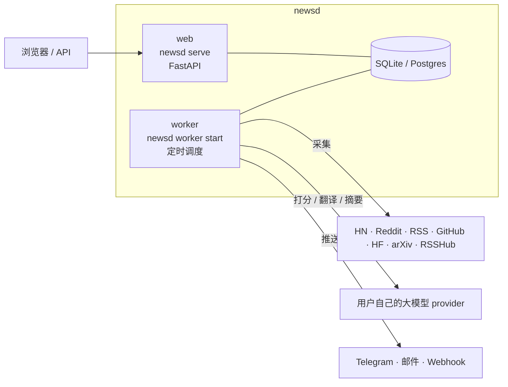

# 架构

- **web**（`newsd serve`）：页面和 API，启动时自动执行数据库迁移。
- **worker**（`newsd worker start`）：在 `NEWSD_WORKER_TIMES` 先采集一次共享池，再逐个用户生成日报，到点推送。
- 两个进程共用同一个数据库，不需要 Redis 或消息队列。数据库默认 SQLite，用户多时换成 Postgres。
- 没有常驻进程的平台（Vercel）上没有 worker：由外部定时器调用受密钥保护的 `/api/cron/tick`，每次调用做 worker 该做的事（到点跑日报、发推送），重复调用不会重复执行。
